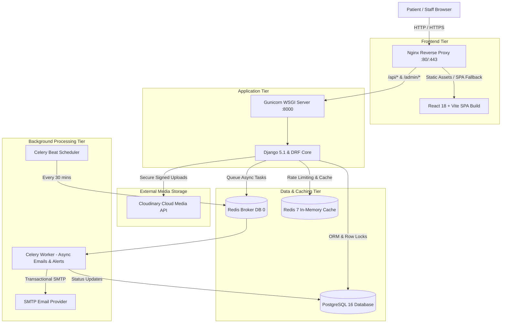
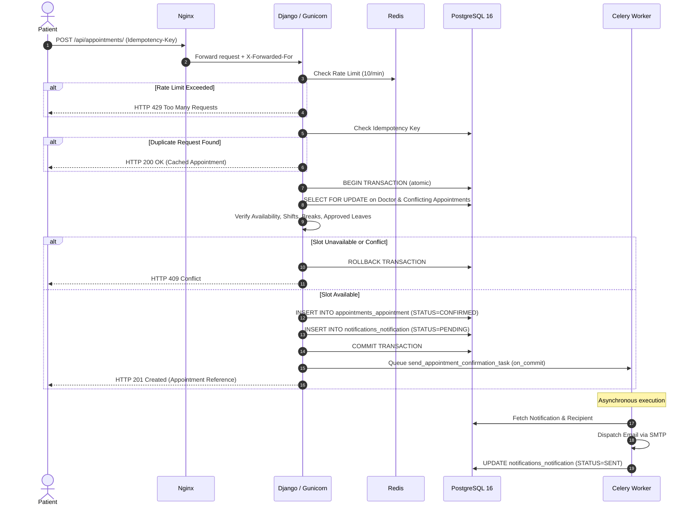

# System Architecture & Technical Design

## Provenance: Phase 0 Foundation → Phase 18 Final Architecture

This document provides the complete system architecture, service topology, data flow, concurrency patterns, security boundaries, and infrastructure specifications for the Eagle Sora Hospital Platform.

---

## 1. High-Level Architectural Overview

The Eagle Sora Hospital Platform is engineered as a decoupled, multi-tier enterprise web application built for clinical reliability, data isolation, and concurrent appointment scheduling.

---

## 2. Service Component Architecture

### 2.1 Web Ingress & Reverse Proxy (Nginx)
- **Container**: `hospital_nginx` (based on `docker/nginx/Dockerfile`)
- **Port Exposure**: Public port `80` (prepared for `443` TLS termination).
- **Static Assets**: Compiles React SPA into `/var/www/frontend` and mounts collected Django static files from `/app/staticfiles` via shared Docker volume `static_volume`.
- **Client IP Preservation**:
  - `proxy_set_header X-Real-IP $remote_addr;`
  - `proxy_set_header X-Forwarded-For $proxy_add_x_forwarded_for;`
  - `proxy_set_header X-Forwarded-Proto $scheme;`
  Ensures Django REST Framework's `NUM_PROXIES = 1` reads true client IP addresses for Redis-backed rate limiting.
- **Client-Side Routing**: Enforces `try_files $uri $uri/ /index.html;` for React Router SPA deep links.
- **Payload Limits**: `client_max_body_size 15M;` (accommodates 5MB photo uploads plus multipart form overhead).

### 2.2 WSGI Application Server (Gunicorn)
- **Container**: `hospital_backend` (based on `docker/backend/Dockerfile`)
- **Configuration**: `backend/gunicorn.conf.py`
- **Concurrency**: 3 worker processes (`(2 x CPU) + 1`), 2 threads per worker using `gthread` worker class.
- **Lifecycle Protection**: `max_requests = 1000` with `max_requests_jitter = 50` to recycle workers periodically and prevent memory leaks.
- **Timeouts**: Worker timeout 120 seconds, keepalive 5 seconds.
- **Logging**: Streams access and error logs directly to container `stdout` and `stderr`.

### 2.3 Backend API Engine (Django & DRF)
- **Framework**: Django 5.1.x, Django REST Framework 3.17.x
- **Configuration**: `backend/config/settings.py` & `backend/config/urls.py`
- **Application Modularization**:
  - `apps.accounts`: Custom User model, Patient profiles, authentication, RBAC.
  - `apps.hospital`: Hospital profile, facilities, announcements, FAQs.
  - `apps.departments`: Clinical departments, specialized services, department FAQs.
  - `apps.doctors`: Doctor profiles, specialties, Cloudinary media associations.
  - `apps.scheduling`: Weekly schedules, breaks, leave approvals, schedule overrides.
  - `apps.appointments`: Appointment booking engine, slot generator, concurrency locks, state machine.
  - `apps.notifications`: Audit logs, notification tracking, Celery task definitions.

### 2.4 Relational Database (PostgreSQL 16)
- **Container**: `hospital_postgres` (`postgres:16-alpine`)
- **Isolation**: Internal Docker network `hospital_network` (no external exposure in production).
- **Volume**: `postgres_data` ensures complete data persistence across container restarts.
- **Integrity**: Enforces relational constraints (`PROTECT`, `CASCADE`), unique index constraints, and database-level transactional consistency. SQLite is strictly prohibited.

### 2.5 Cache & Broker (Redis 7)
- **Container**: `hospital_redis` (`redis:7-alpine`)
- **Database 0**: Celery task message broker (`redis://redis:6379/0`).
- **Database 1**: Django application cache, session cache, and DRF rate-limiting buckets (`redis://redis:6379/1`).
- **Persistence**: `appendonly yes` writing to named volume `redis_data`.

### 2.6 Asynchronous Processing (Celery Worker & Beat)
- **Worker Container**: `hospital_celery_worker` (`celery -A config worker --concurrency=2 -E`)
  - Executes confirmation, cancellation, and reschedule emails asynchronously.
  - Enforces bounded retries (3 retries with exponential backoff: 5s, 10s, 20s).
  - Transaction-safe dispatch via `transaction.on_commit()` ensures failed DB transactions never dispatch orphaned notifications.
- **Beat Container**: `hospital_celery_beat` (`DatabaseScheduler`)
  - Runs periodic scan every 30 minutes (`apps.notifications.tasks.send_appointment_reminders_batch_task`).
  - Scans upcoming 24-hour window, enforces idempotency, and filters cancelled appointments.

### 2.7 Media Storage (Cloudinary)
- **Integration**: Cloudinary Python SDK via `backend/apps/hospital/media.py`.
- **Validation**: Strict Pillow binary verification, MIME whitelist (`image/jpeg`, `image/png`, `image/webp`), and 5MB size limit.
- **Safe Replacement**: Uploads and verifies new asset in Cloudinary, persists reference in PostgreSQL, then destroys previous Cloudinary asset.
- **Secret Masking**: Cloudinary credentials and internal tracebacks are strictly excluded from API responses and log files.

---

## 3. Data Flow & Booking Concurrency Model

---

## 4. Authentication, Roles & Authorization Topology

### 4.1 Token Lifecycle
- **Tokens**: SimpleJWT Bearer tokens.
- **Access Token**: 60-minute expiration.
- **Refresh Token**: 7-day expiration.
- **Logout / Revocation**: Refresh tokens are blacklisted upon logout via `token_blacklist` app.

### 4.2 Role-Based Access Control (RBAC) Matrix
| Resource / Action | Anonymous | Patient | Doctor Staff | Hospital Admin | Super Admin |
|---|---|---|---|---|---|
| View Public Content (Hospitals, Depts, Doctors) | ALLOW | ALLOW | ALLOW | ALLOW | ALLOW |
| Query Available Slots | ALLOW | ALLOW | ALLOW | ALLOW | ALLOW |
| Register Account | ALLOW (PATIENT only) | DENY | DENY | DENY | DENY |
| Book Appointment | DENY | ALLOW (Self only) | DENY | ALLOW (Admin booking) | ALLOW |
| View Own Appointments | DENY | ALLOW | ALLOW (Assigned doc) | ALLOW (All) | ALLOW (All) |
| Cancel / Reschedule Own Appointment | DENY | ALLOW | DENY | ALLOW | ALLOW |
| Upload Doctor Photo | DENY | DENY | ALLOW (Self doctor) | ALLOW (Any doctor) | ALLOW (Any doctor) |
| Manage Schedules / Breaks / Overrides | DENY | DENY | ALLOW (Self doctor) | ALLOW (Any doctor) | ALLOW (Any doctor) |
| Manage Departments / Hospital Content | DENY | DENY | DENY | ALLOW | ALLOW |
| View Audit Logs | DENY | DENY | DENY | ALLOW | ALLOW |

---

## 5. Security & Isolation Architecture

1. **Network Isolation**: All internal stateful services (PostgreSQL, Redis, Celery, Gunicorn) exist inside `hospital_network`. Only Nginx publishes port 80/443.
2. **SQL Injection Prevention**: 100% parameterization via Django ORM. Raw SQL queries are prohibited.
3. **Cross-Site Scripting (XSS)**: Input validation, plain-text serialization, and React's default auto-escaping.
4. **Clickjacking & MIME Sniffing Protection**:
   - `X-Frame-Options: DENY`
   - `X-Content-Type-Options: nosniff`
   - `Referrer-Policy: same-origin`
5. **IDOR & Object-Level Isolation**: Permissions enforce ownership checks (`obj.patient == request.user.patient_profile` or `obj.doctor.user == request.user`).
6. **Exception Sanitization**: In production (`DEBUG=False`), unhandled exceptions return a standardized error JSON (`{"error": "Internal server error."}`) with no leaked call stacks or connection strings.
