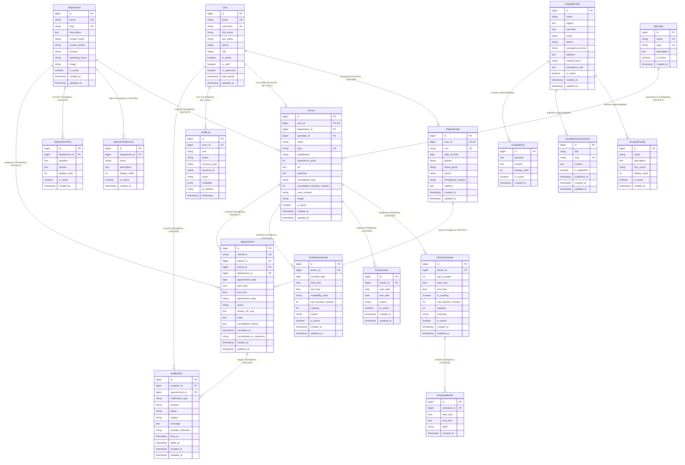

# Entity Relationship Diagram (ERD) & Backend Domain Models

## Provenance: Phase 0 Foundation (Initial) → Phase 10 Backend Domain Models Specification

This document provides the complete PostgreSQL domain model schema specification, relationship diagrams, constraints, choices/enums, and deletion behaviors for the Eagle Sora Hospital Platform. Initialized in Phase 0 Foundation.

---

## 1. Visual Entity Relationship Diagram (Mermaid)

---

## 2. Domain Models & Architecture Breakdown

### 2.1 Accounts Domain (`backend/apps/accounts`)
- **`User`**: Custom user inheriting from `AbstractUser`. Uses `email` as `USERNAME_FIELD` (case-insensitive uniqueness via custom UserManager).
  - **Roles**:
    - `SUPER_ADMIN` — System superuser with complete access.
    - `HOSPITAL_ADMIN` — Hospital administration staff managing doctors, schedules, announcements, and metrics.
    - `DOCTOR_STAFF` — Medical staff managing appointments, overrides, and leaves.
    - `PATIENT` — Public registered patient booking and reviewing appointments.
- **`PatientProfile`**: Linked via `OneToOneField(User, on_delete=CASCADE)`. Contains medical record number (`mrn`), gender, blood group, emergency contact details, and residential address. Does not store sensitive clinical notes.

### 2.2 Hospital Domain (`backend/apps/hospital`)
- **`HospitalProfile`**: Singleton-style institutional overview holding facility name, overview, emergency contacts, visiting hours, and address.
- **`HospitalFacility`**: Hospital amenities and infrastructure items (e.g. ICU, 24/7 Pharmacy, Diagnostic Lab).
- **`HospitalAnnouncement`**: Public announcements with slugs and publication dates.
- **`HospitalFAQ`**: Institutional frequently asked questions.

### 2.3 Departments Domain (`backend/apps/departments`)
- **`Department`**: Medical specialties/divisions (e.g. Cardiology, Neurology) with unique slugs, operating hours, and contact details.
- **`DepartmentService`**: Specific clinical procedures or services offered by the department.
- **`DepartmentFAQ`**: Department-specific frequently asked questions.

### 2.4 Doctors Domain (`backend/apps/doctors`)
- **`Specialty`**: Distinct medical specialty classifications (e.g. Interventional Cardiology).
- **`Doctor`**: Medical practitioner profile. Linked optionally to `User` (`OneToOneField, on_delete=SET_NULL`), `Department` (`ForeignKey, on_delete=PROTECT`), and `Specialty` (`ForeignKey, on_delete=PROTECT`).
  - Supports bio, qualifications, experience years, consultation duration (minutes), consultation type (`IN_PERSON`, `VIDEO`, `BOTH`), and profile image.

### 2.5 Scheduling Domain (`backend/apps/scheduling`)
- **`DoctorSchedule`**: Weekly recurring availability template for each doctor (days 0–6, Monday–Sunday). Defines `start_time`, `end_time`, `slot_duration_minutes`, `capacity`, and IANA `timezone`.
- **`ScheduleBreak`**: Daily break intervals within a schedule (e.g. Lunch 13:00–14:00).
- **`DoctorLeave`**: Multi-day or single-day leaves requested by the doctor.
- **`ScheduleOverride`**: Date-specific schedule exceptions overriding the weekly pattern (e.g. custom shifts, emergency unavailability).

### 2.6 Appointments Domain (`backend/apps/appointments`)
- **`Appointment`**: Core booking entity connecting `PatientProfile`, `Doctor`, and `Department`.
  - **Reference**: High-entropy human-readable identifier (`APT-YYYY-XXXXXX`), unique and indexed.
  - **Lifecycle States** (matching PDF specifications):
    - `REQUESTED` — Awaiting administrative/clinic confirmation.
    - `CONFIRMED` — Confirmed and scheduled.
    - `CHECKED_IN` — Patient has arrived at the clinic/hospital.
    - `COMPLETED` — Consultation concluded.
    - `CANCELLED` — Consultation cancelled (retains `cancellation_reason` and `cancelled_at`).
    - `NO_SHOW` — Patient failed to attend.
    - `RESCHEDULED` — Replaced by a new appointment reference.

### 2.7 Notifications & Audit Domain (`backend/apps/notifications`)
- **`Notification`**: Audit of outgoing communications across channels.
  - **Types**: `APPOINTMENT_CONFIRMATION`, `APPOINTMENT_REMINDER`, `APPOINTMENT_CANCELLATION`, `APPOINTMENT_RESCHEDULE`, `ADMIN_ALERT`.
  - **Channels**: `EMAIL`, `SMS`, `SYSTEM`.
  - **Statuses**: `PENDING`, `SENT`, `FAILED`.
- **`AuditLog`**: Immutable activity trail recording user actions, resource references, results, and JSON metadata.

---

## 3. Database Constraints & Validations

| Model | Constraint / Rule | Type | Description |
|---|---|---|---|
| `User` | `email` unique | `UniqueConstraint` | Ensures email addresses are globally unique across all accounts. |
| `PatientProfile` | `mrn` unique | `UniqueConstraint` | Unique Medical Record Number per patient. |
| `Department` | `name` & `slug` unique | `UniqueConstraint` | Prevents naming or routing collisions. |
| `Specialty` | `name` & `slug` unique | `UniqueConstraint` | Prevents naming or routing collisions. |
| `Doctor` | `slug` unique | `UniqueConstraint` | URL slug uniqueness for public doctor profile routing. |
| `DoctorSchedule` | `(doctor, day_of_week)` unique | `UniqueConstraint` | Exactly one weekly schedule rule per doctor per day. |
| `DoctorSchedule` | `start_time < end_time` | `CheckConstraint` + `clean()` | Ensures valid non-inverted time windows. |
| `DoctorSchedule` | `slot_duration_minutes > 0` | `CheckConstraint` | Positive slot duration. |
| `DoctorSchedule` | `capacity > 0` | `CheckConstraint` | Positive patient capacity per slot. |
| `ScheduleBreak` | `start_time < end_time` | `CheckConstraint` + `clean()` | Ensures valid break time windows. |
| `DoctorLeave` | `start_date <= end_date` | `CheckConstraint` + `clean()` | Ensures end date never precedes start date. |
| `ScheduleOverride` | `start_time < end_time` | `CheckConstraint` + `clean()` | Valid override operational hours. |
| `Appointment` | `reference` unique | `UniqueConstraint` | Safe, unforgeable external appointment reference. |
| `Appointment` | `start_time < end_time` | `CheckConstraint` + `clean()` | Valid consultation duration window. |

---

## 4. Deletion Strategy & Data Integrity

Critical clinical and scheduling records are protected against cascade deletion:

- **`Appointment -> Doctor`**: `on_delete=models.PROTECT`. Doctors with historical appointments cannot be hard-deleted; their records are retained and deactivated via `is_active=False`.
- **`Appointment -> Department`**: `on_delete=models.PROTECT`. Departments with appointments cannot be casually removed.
- **`Appointment -> PatientProfile`**: `on_delete=models.PROTECT`. Historical appointments remain attached to patient records for clinical continuity.
- **`Doctor -> User`**: `on_delete=models.SET_NULL`. Deleting a staff user account does not destroy doctor historical records or associations.
- **`AuditLog -> User`**: `on_delete=models.SET_NULL`. Deleting a user account retains historical audit trail logs with `actor=NULL`.
- **`Notification -> User` / `Appointment`**: `on_delete=models.CASCADE`. Notifications are transient operational records cleanly purged if the parent entity is purged.
- **Sub-entities** (`DoctorSchedule`, `ScheduleBreak`, `DoctorLeave`, `DepartmentService`, `DepartmentFAQ`): `on_delete=models.CASCADE` when parent doctor or department is intentionally decommissioned.

---

## 5. Indexing Strategy

To guarantee sub-second read performance for appointment lookups, doctor listings, and administrative dashboards, indexes are created on:

- **Appointments**: `reference` (unique index), `(doctor, appointment_date, status)`, `(patient, appointment_date)`, `appointment_date`, `status`.
- **Doctors**: `slug` (unique index), `(department, is_active)`, `(specialty, is_active)`.
- **Schedules**: `(doctor, day_of_week, is_active)`.
- **Overrides**: `(doctor, override_date)`.
- **Leaves**: `(doctor, start_date, end_date)`.
- **Notifications**: `(recipient, status)`, `(appointment, notification_type)`, `status`, `created_at`.
- **Audit Logs**: `(actor, timestamp)`, `(resource_type, resource_id)`, `timestamp`.
